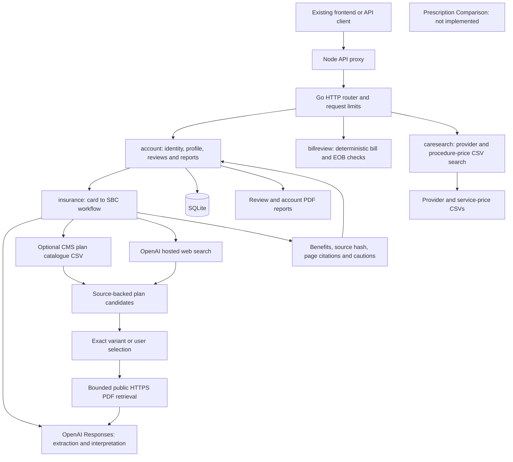
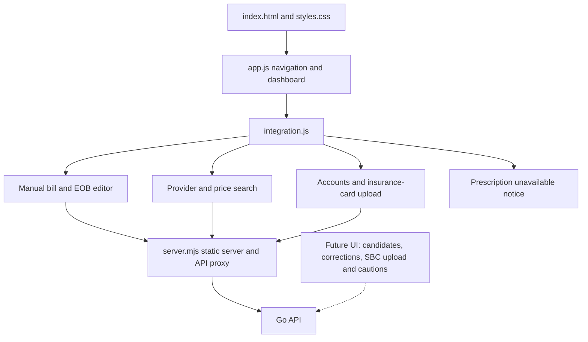
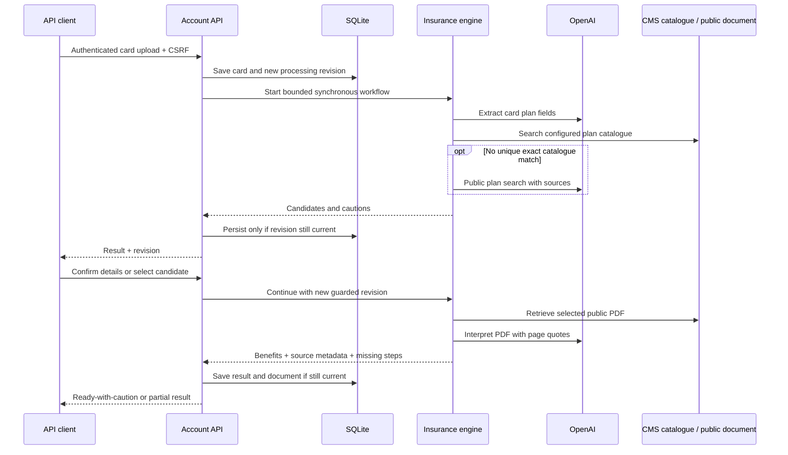

# ClearCare architecture

The active server is a single Go application in [backend/goapp](backend/goapp). The product features are **Bill Review, Care Search, and Prescription Comparison**. Accounts and insurance-plan import are shared capabilities. These packages are modules in one process, not separately deployed microservices.

## Backend graph

## Frontend graph: existing code, unchanged in this iteration

The frontend's existing card copy still describes lookup as unavailable. The backend now runs it, but this iteration deliberately does not update frontend files. The complete workflow can be used through the [API](docs/API.md).

## Insurance processing sequence

Confirmed details plus one exact CMS plan variant/year/state match can proceed through retrieval and interpretation without candidate selection. Extracted-but-unconfirmed details and web candidates require confirmation. Manual SBC upload enters at the document interpretation stage.

## Modules and boundaries

| Module | Responsibility |
|---|---|
| [main.go](backend/goapp/main.go) | HTTP route registration, loopback listener, origin policy, actual request-body limit |
| [account/api.go](backend/goapp/account/api.go) | Sessions, CSRF, account/profile/review endpoints, card storage, reports |
| [account/insurance.go](backend/goapp/account/insurance.go) | Insurance endpoints, persistence, revision guards, four-minute workflow deadline |
| [insurance/workflow.go](backend/goapp/insurance/workflow.go) | Stage orchestration, deterministic matching, cautions, evidence acceptance |
| [insurance/openai.go](backend/goapp/insurance/openai.go) | Responses API, strict JSON schemas, PDF/image input, sourced web search |
| [insurance/catalog.go](backend/goapp/insurance/catalog.go) | Optional local CMS/normalized CSV catalogue |
| [insurance/fetch.go](backend/goapp/insurance/fetch.go) | Public HTTPS PDF retrieval, redirect/DNS validation and size/time limits |
| [billreview](backend/goapp/billreview) | Existing user-confirmed bill arithmetic, duplicates, vague charges, EOB checks |
| [caresearch](backend/goapp/caresearch) | Existing CSV validation, directory and price queries |

No framework or Python runtime is used by the active server. SQLite, scrypt and PDF generation use pinned Go dependencies. The historical Python packages remain for reference and are not started by [dev.mjs](dev.mjs).

## Persistence and concurrency

SQLite tables: `users`, `sessions`, `reviews`, `insurance_cards`, and `insurance_workflows`. Workflow rows contain an opaque revision, JSON result, and optional SBC bytes. A new card replaces the previous card and invalidates its derived result. User actions require the latest revision. A late external response cannot resurrect deleted data or overwrite a replacement card. Account deletion removes cards and workflow rows in the account transaction.

The workflow is synchronous, bounded by four minutes. GET can inspect persisted processing state during a request. An abandoned processing row older than five minutes is reported as interrupted and is retryable. This is not a durable background job queue; a server restart interrupts in-flight work. Retrying does not resume an OpenAI conversation. There is no hidden retry loop that can repeatedly incur charges.

## External data and limits

Card/SBC bytes are sent to OpenAI; search receives only plan fields, not member identifiers or the card file. The app requests `store: false`. The server fetches public PDF sources with a 10 MB cap and 45-second HTTP timeout. OpenAI calls have 90-second timeouts. Raw external errors are reduced to stable caution codes without echoing documents or credentials.

SBC results describe plan terms. They do not establish active membership, remaining deductible, network participation, or authorization for care. Citations are AI-extracted page references and quotes, retained with the source/hash for human inspection. They are not independently verified by a second PDF parser.

See [operations](docs/OPERATIONS.md), [API contract](docs/API.md), and [product specification](docs/PRODUCT.md) for details and remaining work.
