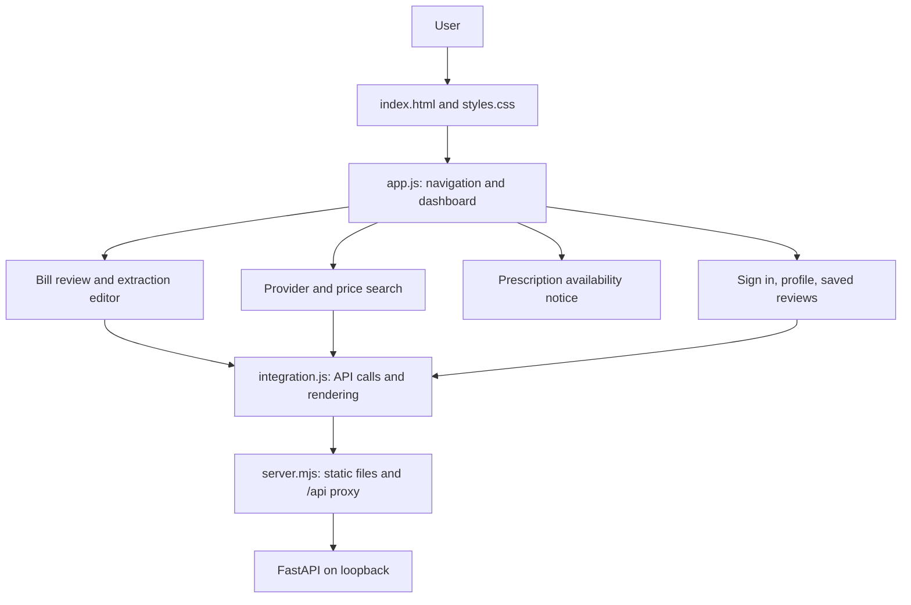
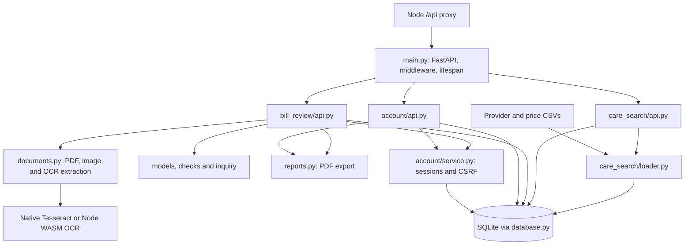

# ClearCare architecture

**Rewrite status:** A partial Go implementation is being developed in `backend/goapp/`. It is not wired into the application and does not yet support accounts, document extraction, saved reviews, or PDF exports. The diagrams below describe the existing Python application, not the incomplete Go implementation.

ClearCare is a local-first prototype. The browser talks to a loopback Node server, which serves the frontend and proxies API calls to FastAPI. The API is organized into bill review, care search, and account services. Prescription pricing is presented as unavailable; it has no backend integration.

## Frontend graph

The frontend is vanilla JavaScript. `integration.js` adds API-backed screens to the shell and holds the active review in browser memory. No health data is stored in localStorage. The Node server serves an explicit asset allowlist and forwards `/api/` requests to port 8000.

## Backend graph

`dev.mjs` starts both servers on loopback. `main.py` composes the three routers, applies request middleware and CORS, initializes account tables, and loads reference data at startup. The routers retain the existing URLs:

| Service | Responsibilities | API paths |
|---|---|---|
| Bill review | Extract documents, analyze reviewed fields, manage saved reviews, generate review PDFs | `/sample`, `/documents/extract`, `/bills/analyze`, `/reviews`, `/reviews/{id}`, `/reviews/{id}/pdf`, `/reports/pdf` |
| Care search | Load CSV reference data and query providers and prices | `/providers`, `/prices/compare`, `/data/status`, `/data/reload` (disabled) |
| Account | Registration, sessions, profile, account deletion and account PDF | `/auth/*`, `/profile`, `/account`, `/account/pdf` |
| Shared application | Health, middleware and SQLite connection/schema helpers | `/health` |

The account PDF uses bill review's report generator and saved-review records. Account deletion also deletes saved reviews. These are explicit cross-feature dependencies; the three folders are modules in one application, not independently deployed services.

## Data and trust boundaries

A signed-in user uploads a bill and optional EOB for local extraction. Text and suggestions return to the browser for review; original files and raw extraction text are not saved. Confirmed fields are analyzed by deterministic rules. Saving a review stores its structured request and findings in SQLite. Reports are generated on request.

Provider and price CSVs are imported at startup; demo mode uses fictional data. SQLite also holds accounts, hashed session tokens, CSRF tokens and saved reviews. Its default path is `backend/clearcare.db`, configurable with `CLEARCARE_DB`. Passwords use scrypt; the cookie is HttpOnly and SameSite Strict, with optional Secure. Authenticated mutations check CSRF. The database is not application-encrypted. There is no email recovery, coverage verification, medication feed, or cloud extraction service. See the root README for operational limitations.

## Verification

Run `npm run check` for JavaScript syntax and `.venv/bin/python -m pytest backend/tests -q` for Python tests. OCR tests require a local OCR engine or the downloaded model and Node dependencies. Python dependencies are pinned in `backend/requirements-lock.txt`; Node dependencies are pinned in `package-lock.json`.
