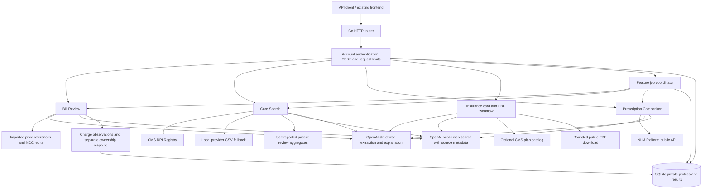
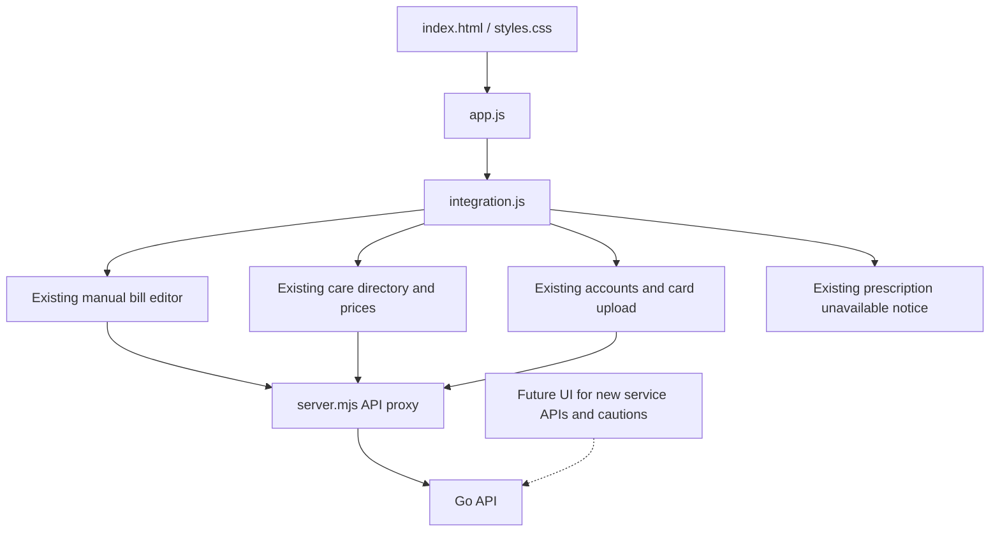

# ClearCare architecture

One Go process implements three product services: Bill Review, Care Search and Prescription Comparison. Accounts, insurance import and evidence handling are shared support. The frontend is unchanged by this implementation.

## Backend graph

## Frontend graph: existing interface

Existing screens do not yet expose the new automated service flows. Backend additions do not imply UI completion.

## Modules

| Module | Responsibility |
|---|---|
| [main.go](backend/goapp/main.go) | Routes, loopback server, origin policy, 21 MB request cap |
| [account](backend/goapp/account/) | Identity, CSRF, account/profile, preferences, private results, observations, PDF reports |
| [billreview](backend/goapp/billreview/) | Bill/EOB extraction, deterministic checks, benchmark differences, imported NCCI review flags, explanation |
| [caresearch](backend/goapp/caresearch/) | Directory/price CSVs, NPI API, patient preferences, cohort matching, AI source enrichment |
| [prescription](backend/goapp/prescription/) | RxNorm lookup, exact-product price research, source-filtered offers |
| [insurance](backend/goapp/insurance/) | Card/SBC orchestration, Responses client, structured output, web search, safe PDF retrieval |
| [evidence](backend/goapp/evidence/) | Shared caution contract, bounded public JSON requests and input/schema helpers |

The existing Responses client remains in the insurance support package and exposes shared structured/document/search methods. Product packages call those methods rather than maintaining separate AI clients. HTTP dependencies are standard-library clients; no Python runtime is present.

## Processing and persistence

Product feature requests are accepted as background jobs with a four-minute deadline. Job status, progress stage, cancellation state, result ID and completed JSON are persisted; request bodies and uploads remain in memory and are not stored in the job table. Two jobs execute concurrently. An active request hash prevents duplicate submissions for the same user and feature. A process restart marks queued/running jobs `interrupted`; clients can submit again. Public JSON requests have a 25-second timeout; OpenAI calls 90 seconds; SBC retrieval 45 seconds. Automated endpoints allow six requests per minute per account, held in memory and reset on restart.

Insurance uses revision-guarded processing rows, preventing stale results from overwriting replacement cards. Its stale processing state becomes retryable after five minutes. Product services persist successful JSON results, including partial results, in `feature_runs`. Retrying a product action creates a separate result. A database failure returns an error instead of claiming a saved result.

Tables:

- `users`, `sessions`, `reviews`: account and existing manual review records.
- `insurance_cards`, `insurance_workflows`: private card/SBC bytes and insurance state.
- `patient_preferences`: optional patient demographics and care preferences.
- `feature_runs`: owner, feature, timestamp and private result JSON.
- `feature_jobs`: durable job lifecycle/progress, request hash, completed result and result reference; no uploaded bytes.
- `charge_observations`: facility NPI, procedure code, charge, benchmark, difference, price type and source; no patient/claim/date fields.
- `observation_owners`: private observation-to-user/result mapping.

Schema changes use versioned, transactional `schema_migrations`. Results and completed jobs expire after 90 days by default, configurable through `CLEARCARE_RESULT_RETENTION_DAYS`. Account deletion removes owned records transactionally. Result deletion removes linked observations. The entire database is not anonymous because ownership mappings and private results exist.

## Evidence boundaries

Bill AI extraction keeps unknown amounts null and requires confirmation before analysis. Price benchmarks require applicable imported source rows; source search does not silently turn snippets into authoritative prices. NCCI matches are review flags with modifier/context cautions.

Care recommendations begin with public registry or sourced local identities. Demographics describe the patient. Cohort matching is local, explicit opt-in, and uses self-reported aggregate data. AI enrichment receives public provider identities and service preferences, not patient demographics. It can add source-backed language/telehealth/accessibility matches but cannot certify network participation or clinical quality.

Prescription comparisons first resolve the user-selected RxNorm product, then require exact product name, quantity, ZIP, price type, currency, quote and a URL returned by web search. AI-extracted evidence still requires pharmacist/source confirmation; there is no pharmacy checkout integration.

OpenAI requests set `store: false`, which is not a guarantee about all provider retention policies. Document contents and public research attributes leave the server when their corresponding integrations run. Details, limits and remaining verification are in [operations](docs/OPERATIONS.md), [API](docs/API.md), and the [data guide](backend/DATA_COLLECTION.md).

## Result presentation boundary

[evidence/grid.go](backend/goapp/evidence/grid.go) defines a versioned grid contract. Each product constructs its own items explicitly; there is no key-name inference at serialization time. HTTP clients receive ordered display fields with available/unknown status, source links, relevant item cautions and stable IDs. Raw web-search narrative remains internal, while `research_grid` exposes source cards separately. Saved results retain the same product-built grid.
